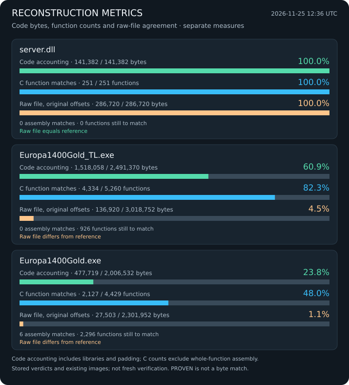
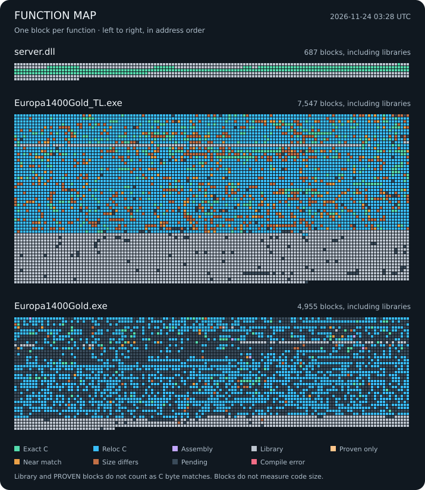
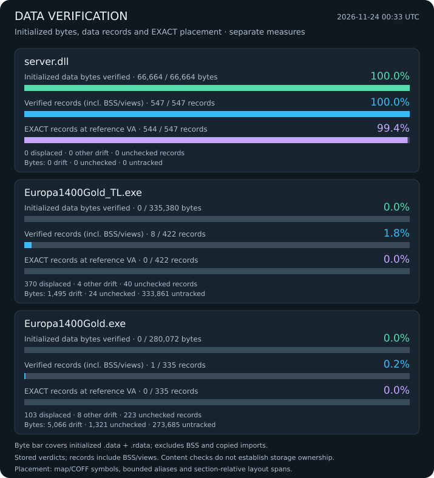

# Guild Rebrew

A C89 reconstruction of Europa 1400: The Guild. The goal is to recover one
shared source tree and reproduce the raw MSVC6 builds of `server.dll`,
`Europa1400Gold_TL.exe` (GoldTL), and `Europa1400Gold.exe` (Gold).
[Reconstruction objective](goal.md)

<a id="get-started"></a><a id="build-and-compare"></a><a id="4-build-the-compiler-images"></a><a id="5-compile-serverdll-with-cmake"></a><a id="6-compare-the-result-with-the-original"></a><a id="work-together"></a><a id="1-install-and-check-build-dependencies"></a><a id="2-clone-and-create-the-python-environment"></a><a id="3-supply-the-original-server-dll"></a><a id="reference-provenance"></a>

## Start here

- [Build and compare the server](docs/build.md) using the pinned environment and your own legally obtained game files.
- [Build the client comparison scaffolds](stubs/README.md).
- [Choose a reconstruction task](docs/TODO.md) and read the [project rules](AGENTS.md).
- [Find contributor guides, research and release notes](docs/README.md).

## Reconstruction status

<a id="data-verification"></a>

The existing server build matches its reference. The most recent release gate
passed at the [1.17.0 checkpoint](docs/releases/1.17.0.md#validation). Both client
builds use placeholders and differ from their references. The charts show stored
verdicts and measurements of existing builds. [Current measurements and open work](docs/TODO.md)

Code accounting includes libraries and padding. C function matches count object
`EXACT`, linked `EXACT` and `RELOC` for game functions, excluding whole-function
assembly.

<details>
<summary>Reconstruction metrics: code accounting, C function matches and raw-file comparison</summary>



</details>

<details>
<summary>Function map: C matches, libraries, assembly and unfinished functions</summary>



</details>

<details>
<summary>Data verification: initialized bytes, data records and exact placement</summary>



</details>

<details>
<summary>Refresh status graphics</summary>

Keep sources and metadata stable during the refresh. The function map checks the
snapshot against live project state.

```sh
mkdir -p .scratch
uv run --frozen rebrew status --all-targets --json > .scratch/status.json
uv run --frozen python scripts/progress_svg.py < .scratch/status.json > docs/assets/reconstruction-status.svg
uv run --frozen python scripts/progress_svg.py --map < .scratch/status.json > docs/assets/function-map.svg
uv run --frozen python scripts/progress_svg.py --data < .scratch/status.json > docs/assets/data-verification.svg
```

</details>

## Work on a function

```sh
uv run --frozen rebrew todo --target Europa1400Gold_TL.exe --json
uv run --frozen rebrew source findings 0x00499950 --json
uv run --frozen rebrew test 0x00499950 --no-promote --json
```

Use the selected function's address in the last two commands. Check library
attribution and native evidence before editing C. GoldTL is the default target.
Pass `--target server.dll` or `--target Europa1400Gold.exe` for the other targets.
[Reconstruction workflow](docs/workflow-traps.md)

<a id="project-map"></a>

## Project layout

| Path | Purpose |
| --- | --- |
| [src/Develop/](src/README.md) | Shared C sources |
| [stubs/](stubs/README.md) | Client comparison placeholders |
| `references/` | Vendor sources, patches and dependency inputs |
| `db/inventory-*.json` | Native function inventories |
| `layout/` | Link order and layout inputs |
| `rebrew-*.toml` | Project configuration and managed metadata |
| [docs/](docs/README.md) | Guides, measurements and research |

<a id="optional-coverage-dashboard"></a>

## Optional dashboard

```sh
uv run --frozen --extra dashboard recoverage serve
```

Open the URL printed by the server. The dashboard reads local sources, metadata
and reference binaries. Stored verdicts can predate working-tree edits.

## License

Earlier README versions named MIT. The repository has no LICENSE file or package
license field to confirm those terms. Third-party sources retain their notices.
