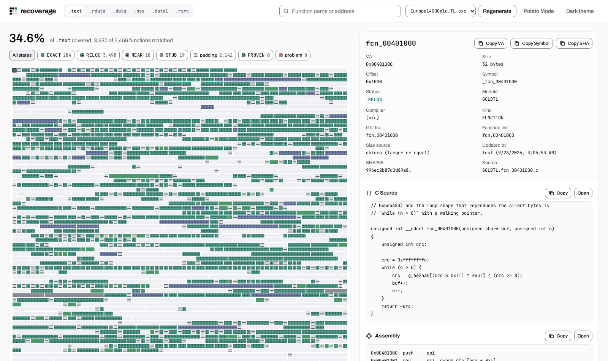
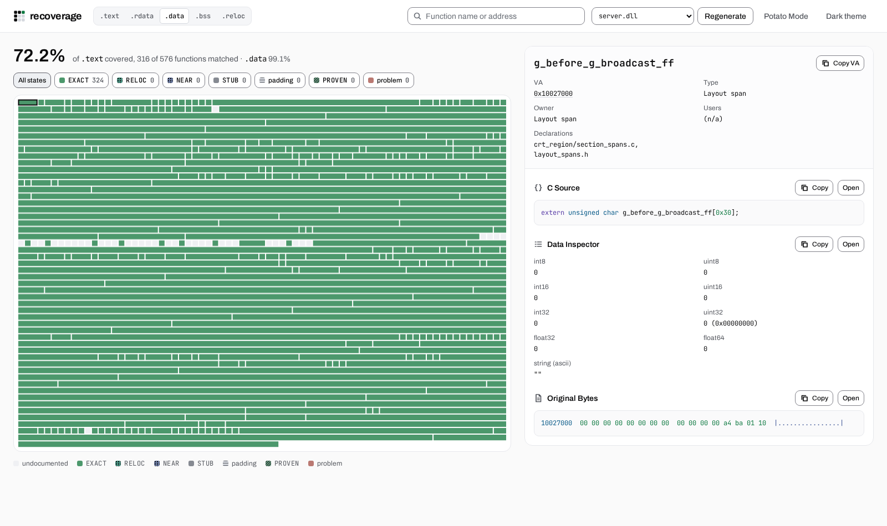

# Guild Rebrew

**Three binaries. One faithful source tree.**

Reconstructing **Europa 1400: The Guild** in C89 with the original MSVC6
toolchains. The [objective](goal.md): reproduce every byte of the server,
Gold and GoldTL from shared source.

> [!IMPORTANT]
> **The existing server build is byte-identical:** all **286,720 bytes** match.
> The fresh image/data check passes all 652 compared data symbols.
> **Gold and GoldTL are comparison scaffolds, not playable or byte-identical.**
> Both clients have linked as raw comparison executables with same-build maps.
> The configured GoldTL audit EXE is unavailable while its rebuild is in progress.
> Source recovery, unsupported assembly and provider/storage work remain.
> The [last completed server gate](docs/TODO.md#verified-checkpoint) confirmed
> complete file equality and passed; it does not verify later source edits.

The [latest recorded work](docs/TODO.md)
includes ongoing source reorganization and fresh data checks. Function counts
below describe the current working tree; linked images are separate snapshots
with substantial stubs and layout differences. See the [handoff](docs/HANDOFF.md).

**[Start here](#get-started)** &nbsp; · &nbsp;
**[Build & compare](#build-and-compare)** &nbsp; · &nbsp;
**[Dashboard](#optional-coverage-dashboard)** &nbsp; · &nbsp;
**[Current work](docs/TODO.md)** &nbsp; · &nbsp;
**[Documentation](docs/README.md)**

---

## Reconstruction status

| Target | Code accounted for | C functions matched | Raw file at original offsets |
| --- | ---: | ---: | ---: |
| **Server** | **97.9%** | 247 / 251 · 98.4% | 100.0% |
| **GoldTL** | **51.4%** | 3,835 / 4,946 · 77.5% | N/A |
| **Gold** | **20.8%** | 1,882 / 4,426 · 42.5% | 1.1% |

**Code accounting** is Rebrew's byte-based measure of virtual `.text`: matched
functions, identified libraries and alignment padding. **Function matches**
give every function equal weight, regardless of size. **Raw-file agreement**
compares the existing built file with the reference at original offsets;
displaced code still differs there. None of these alone establishes completion.
**N/A** means the configured built image is missing; an older score is not reused.

<!-- progress:start -->
<p align="center">
  
</p>
<details>
  <summary><strong>Explore the function map</strong>, one block per function, in address order</summary>
  <p align="center">
    
  </p>
</details>
<!-- progress:end -->

<sub>Snapshot refreshed 2026-10-24 18:38 UTC from
<code>rebrew status --all-targets --json</code>. Function counts reflect stored
verdicts and ongoing, uncommitted source/binding changes, not a fresh compilation.
The server's existing raw image remains identical even though four current source
claims are unverified. Server and Gold data were rechecked; GoldTL has no current
audit EXE and its map is empty during the rebuild. TL data below retains the last
successful check, not a fresh result. Libraries, semantic PROVEN verdicts and
whole-function assembly matches are excluded from C totals. Inline assembly may
remain.</sub>

The server uses plain VC6 SP5 with `/MT` / LIBCMT. Both clients use the
Processor Pack: GoldTL with `/MT` / LIBCMT, Gold with `/ML` / LIBC.

Gold has another **one whole-function assembly match**, counted separately.
Remaining work in the same snapshot:

| Target | STUB | SIZE_MISMATCH | NEAR_MATCHING | PROVEN only | EXTRACT_ERROR | Without source |
| --- | ---: | ---: | ---: | ---: | ---: | ---: |
| **Server** | 0 | 0 | 0 | 0 | 0 | 4 |
| **GoldTL** | 1 | 1,024 | 81 | 5 | 0 | 0 |
| **Gold** | 36 | 49 | 5 | 0 | 0 | 2,453 |

These categories reflect the current source bindings. A moved or retired claim
can change the counts without changing built bytes or earning a match. GoldTL
still has 1,024 size mismatches despite its low STUB count; a complete body does
not mean byte identity. Function percentages measure entries, not code bytes or
gameplay completeness. All 286,720 existing server bytes match, including imports,
relocations, headers and layout. Client links use explicit comparison
placeholders and remain unsuitable for gameplay. No rebuild, per-function batch
or full gate ran for this data-only refresh.

## Data verification

Data placement refreshed 2026-10-24 19:24 UTC with the upstream Rebrew 6.1.1 fix.
The server now reaches **100% on all three data bars**.

| Target | Initialized data bytes verified | Verified records (incl. BSS/views) | EXACT at reference VA | Displaced records |
| --- | ---: | ---: | ---: | ---: |
| **Server** | 66,664 / 66,664 · 100.0% | 547 / 547 | 547 | 0 |
| **GoldTL** | 0 / 335,380 · 0.0% | 2 / 361 | 0 | 339 |
| **Gold** | 0 / 280,072 · 0.0% | 1 / 319 | 0 | 304 |

<p align="center">
  
</p>

Byte coverage counts each initialized `.data`/`.rdata` byte once; it excludes
BSS and copied imports. Record totals include BSS and views, so a verified
record need not contribute initialized bytes. EXACT requires matching bytes at
a checked reference address. Placement comes from link-map symbols, private
symbols recovered from matching COFF sections, bounded backing-object offsets,
or section-relative layout intervals. A layout span is an interval, not a new
allocation. These checks do not establish source or storage ownership.

The previous 138-record server gap is resolved: 123 layout intervals, four
backing-offset aliases, ten private symbols and one reviewed compiler literal.
No storage or linker symbols were added, and no binary bytes changed. The fresh
server check passes all 652 raw records; the chart excludes imports and other
records outside its 547-record denominator. Client data results remain from
their last stated checks below. GoldTL's audit image is still unavailable during
its rebuild, so it has no fresh data result here.

Gold uses `build/Europa1400Gold.exe`; GoldTL is configured to use
`build-goldtl-audit/Europa1400Gold_TL.exe`. Each needs its matching `.map`.
Once the configured image exists, compare data without recompiling functions
(exit 1 reports scaffold differences):

```sh
uv run rebrew verify --data --target Europa1400Gold.exe
uv run rebrew verify --data --target Europa1400Gold_TL.exe
```

Raw-image diagnostics, with each measurement time:

| Target | Content matches | Differs | Missing | Not comparable | Checked (UTC) |
| --- | ---: | ---: | ---: | ---: | --- |
| **Server** | 652 | 0 | 0 | 0 | 2026-10-24 19:24 |
| **GoldTL** | 125 | 51 | 15 | 172 | 2026-10-24 15:27 (previous build) |
| **Gold** | 83 | 30 | 49 | 159 | 2026-10-24 18:37 |

These diagnostics include imports and bounded virtual-tail checks excluded
from initialized-byte coverage. BSS verification contributes no file bytes;
unknown or out-of-image extents stay uncomparable. Most client records are
displaced, so the
stricter charts retain zero client EXACT data placements. See the
[comparison-build guide](stubs/README.md) for placeholders and build commands.

## Get started

This example starts from a clean checkout and builds **server.dll only** on
Linux x86_64. You need your own original DLL; the client binaries and Miles
archive are not needed for this example.

### 1. Install and check build dependencies

On Debian/Ubuntu, install Git, CMake 3.19+, Make, a C compiler, json-c headers,
and Docker:

```sh
sudo apt-get update
sudo apt-get install -y git curl ca-certificates cmake make build-essential \
  pkg-config libjson-c-dev docker.io util-linux
sudo systemctl enable --now docker
sudo usermod -aG docker "$USER"
```

Log out and back in so the Docker group membership takes effect.

Install [uv](https://docs.astral.sh/uv/getting-started/installation/) to manage
Python and this project's environment:

```sh
curl -LsSf https://astral.sh/uv/install.sh | sh
. "$HOME/.local/bin/env"
```

Check the tools before cloning. `docker info` must work as your normal user;
finish Docker's [Linux post-install setup](https://docs.docker.com/engine/install/linux-postinstall/)
if it reports a permission error.

```sh
git --version
cmake --version
make --version
cc --version
pkg-config --modversion json-c
docker info
unshare --user --map-root-user true
```

The configured compiler runner uses `unshare`: it requires unprivileged user
namespaces, rootless overlayfs, and kernel support for `openat2`, `pidfd_open`
and `close_range`. The namespace check above is only the first check. Rebrew
checks the remaining requirements when starting the runner. See the
[runner requirements](https://github.com/maci0/rebrew/blob/main/docs/TOOLCHAIN.md#experimental-unshare-backend)
if your host rejects it. Ubuntu's AppArmor policy can permit `unshare(1)` while
denying Rebrew's helper. The server build below exercises the actual runner;
the namespace check alone does not establish compatibility.

### 2. Clone and create the Python environment

```sh
git clone https://github.com/maci0/guild-rebrew.git
cd guild-rebrew
uv python install 3.14
uv venv --python 3.14
uv sync
uv run rebrew --version
```

`uv sync` installs pinned Rebrew 6.1.1 and the project dependencies into
`.venv` from the public release wheels. This walkthrough was verified with
Python 3.14.9. Run the remaining commands from this repository root; `uv run`
uses that environment without activating it.

### 3. Supply the original server DLL

Copy `Server/server.dll` from your installation of The Guild Gold. Replace the
example source path below with your own:

```sh
mkdir -p original/Server
cp "/path/to/The Guild Gold/Server/server.dll" original/Server/server.dll
sha256sum original/Server/server.dll
```

The expected reference is 286,720 bytes with SHA-256:

```text
3cc2ce9049e41ab6d0eea042df4966fbf57e5e27c67fb923e81709d2683609d1
```

`original/` is ignored by Git. Check [reference provenance](#reference-provenance)
if your DLL has a different hash; a different game version is a different
comparison target.

### 4. Build the compiler images

The server compiles with plain VC6 SP5 and links with the native Microsoft CRT
variant. Both images are needed. Build them from the public
[toolchain recipes](https://github.com/maci0/recompile-toolchains); the commands
also build their shared base image and download checksum-verified inputs.

```sh
git clone https://github.com/maci0/recompile-toolchains.git ../recompile-toolchains
export REBREW_TOOLCHAINS_DIR="$PWD/../recompile-toolchains"
export REBREW_TOOLCHAIN_OVERLAY_DIR="$PWD/cmake/toolchain-overlays"
uv run rebrew toolchain build msvc-6.0-sp5
uv run rebrew toolchain build msvc-6.0-sp5-crt
docker image inspect rebrew/msvc:6.0-sp5-win32 rebrew/msvc:6.0-sp5-crt-win32
```

Docker prepares the images; compilation uses their cached filesystems through
the configured `unshare` runner. Wine and MSVC run inside those filesystems.
No host Wine installation is required.

## Build and compare

### 5. Compile server.dll with CMake

Use a fresh build directory. The toolchain filename retains its `-docker`
suffix; its driver honors the configured `unshare` backend.

```sh
uv run cmake -S . -B build/server-example \
  -DCMAKE_TOOLCHAIN_FILE="$PWD/cmake/toolchain-msvc-6.0-sp5-docker.cmake" \
  -DCMAKE_BUILD_TYPE=Release \
  -DREBREW_BUILD_SERVER=ON \
  -DREBREW_BUILD_GOLD=OFF -DREBREW_BUILD_GOLDTL=OFF \
  -DREBREW_DEBUG_INFO=OFF
uv run cmake --build build/server-example --parallel 2
```

This produces `build/server-example/server.dll` and `server.map`. It builds the
current reconstruction, including remaining assembly bodies. A successful build
does not establish C recovery or a warning-free checkpoint.

### 6. Compare the result with the original

First compare the complete files and show their hashes:

```sh
cmp original/Server/server.dll build/server-example/server.dll
sha256sum original/Server/server.dll build/server-example/server.dll
```

`cmp` prints nothing and exits 0 when every byte agrees. Matching hashes establish
file identity. This recipe was checked on 2026-10-18 in a separate
clean checkout containing only the server reference: the rebuilt DLL matched
every byte. That is a historical checkpoint: the latest working-tree server
build differs by eight bytes. If your hashes differ, your build has not
reproduced the reference.

Then ask Rebrew to compare data, PE sections, imports, exports, resources,
headers and layout against the same reference:

```sh
uv run rebrew verify --target server.dll \
  --built build/server-example/server.dll \
  --data --whole-binary --raw-link --dry-run --json
```

This checks the existing image without recompiling functions or recording new
verdicts. Exit 1 means differences; inspect the JSON report. Always select
`--target server.dll` here: the project default is the GoldTL client.

For source work, start with `uv run rebrew todo --target server.dll --json` and
the [reconstruction rules](AGENTS.md). The [server gate](scripts/gate.sh)
performs broader checks using the conventional `build/` tree; the
[current checkpoint](docs/TODO.md#verified-checkpoint) documents its remaining
lint failures. For Gold and GoldTL, use the separate
[client build recipe](stubs/README.md#build). Their unresolved links must be
repaired before fresh binary comparisons can run.

## Optional coverage dashboard

[Recoverage](https://github.com/maci0/recoverage) 8.4.2 explores this
checkout's live coverage records, source and reference binaries. After creating
the project environment, install that optional dashboard into the same `.venv`
and start it from the repository root:

```sh
uv sync --extra dashboard
uv run --extra dashboard recoverage serve
```

Open [127.0.0.1:8001](http://127.0.0.1:8001/) and stop the server with `Ctrl+C`.
Select a target and section, then click a map block to inspect its source,
disassembly and bytes or its data declarations and values. With only the server
reference supplied, inspect `server.dll`; client views need their own reference
executables.

[](docs/screenshots/dashboard-functions.png)

<details>
<summary><strong>Inspect data and storage relationships</strong></summary>

[](docs/screenshots/dashboard-data.png)

</details>

<sub>Actual Recoverage views captured on 2026-10-18. Map percentages describe
stored coverage records; they do not establish whole-image completion.</sub>

## Project map

| Path | Contents |
| --- | --- |
| `src/Develop/` | Shared reconstruction following attested original paths |
| `src/GOLD*.fcn_*.c` | Client bodies awaiting placement or consolidation |
| `stubs/` | Explicit client comparison placeholders and their limits |
| `references/` | Vendor sources, patches and dependency provenance |
| `db/inventory-*.json` | Tracked native function inventories |
| `layout/server.dll/` | Server link ordering, retention inputs and layout metadata |
| `rebrew-*.toml` | Managed identities, source evidence, types and project configuration |
| `docs/` | Current work, technical references and archived experiments |

Use [existing tooling](docs/tooling-upstream.md) before adding scripts, and
[vendoring rules](docs/vendoring.md) before editing libraries. Rebrew and
Recoverage read canonical project inputs; exported coverage is a snapshot.

## Work together

Use a work branch and pull request for C and metadata changes. The
[collaboration guide](docs/collaboration.md) covers shared ownership and optional
BinSync exchange with decompilers. [Reviewed community research](docs/community-research.md)
separates attested native findings from naming guesses and testing ideas.

<a id="reference-provenance"></a>
<details>
<summary><strong>Reference provenance & checksum</strong></summary>

The authoritative server reference is the untouched GOG Gold DLL, read-only
(`0444`), 286,720 bytes. On 2026-10-02 it was compared directly with
`app/Server/server.dll` from `setup_the_guild_gold_2.0.0.5.exe` and the Steam
Gold v2.06 English international DLL: all three were identical. The GOG-labelled
`gilde-binaries/` directory is a Redump DVD symlink; the installer supplied the
independent provenance check.

```sh
sha256sum --check <<'HASH'
3cc2ce9049e41ab6d0eea042df4966fbf57e5e27c67fb923e81709d2683609d1  original/Server/server.dll
HASH
```

</details>

<details>
<summary><strong>Refresh the status graphics</strong></summary>

The renderer consumes the canonical CLI report; it keeps no separate coverage database.

```sh
status_report=$(mktemp)
uv run rebrew status --all-targets --json > "$status_report"
uv run python scripts/progress_svg.py < "$status_report" > docs/progress.svg
uv run python scripts/progress_svg.py --map < "$status_report" > docs/function-map.svg
uv run python scripts/progress_svg.py --data < "$status_report" > docs/data-progress.svg
rm "$status_report"
```

Update the tables and snapshot time from that same report. When publishing,
commit the graphics first, then pin all three image URLs above to that commit SHA
so GitHub displays the new assets without stale branch-cache responses.

</details>

## License

MIT for project code. Third-party sources retain their own license notices.
