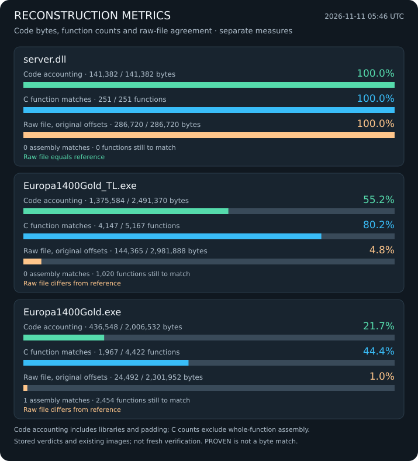
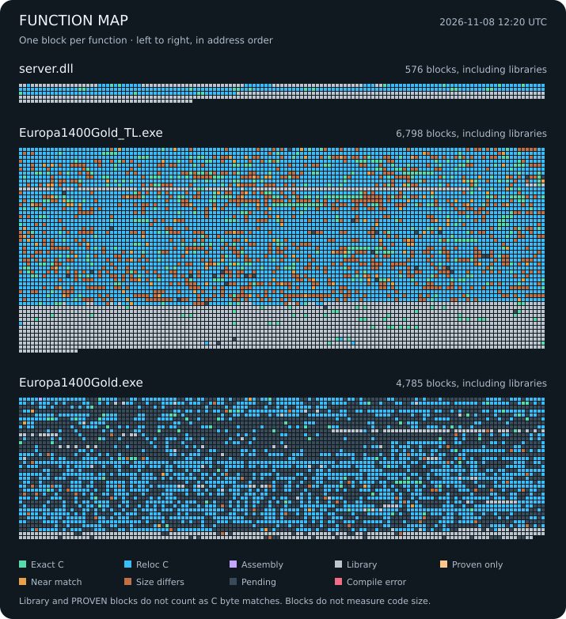
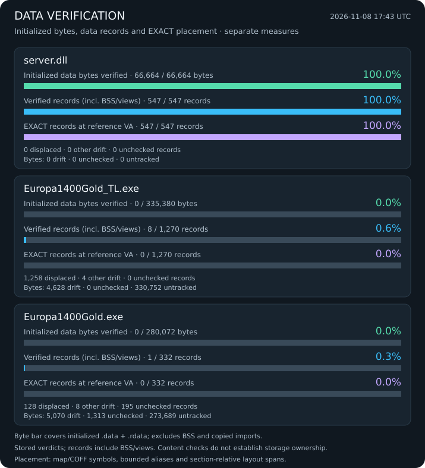

# Guild Rebrew

C89 reconstruction of Europa 1400: The Guild using the original MSVC6 toolchains.
The [objective](goal.md) is one shared source tree that reproduces the complete
server, GoldTL and Gold reference binaries.

<a id="get-started"></a><a id="build-and-compare"></a><a id="4-build-the-compiler-images"></a><a id="5-compile-serverdll-with-cmake"></a><a id="6-compare-the-result-with-the-original"></a><a id="work-together"></a>

## Start here

- [Build the server](docs/build.md), including prerequisites and reference input.
- [Build the client comparison scaffolds](stubs/README.md).
- [Find documentation](docs/README.md) or review the [project rules](AGENTS.md).
- [Contribute source or analysis](docs/collaboration.md).

<a id="1-install-and-check-build-dependencies"></a><a id="2-clone-and-create-the-python-environment"></a>

Quick setup after installing the [build prerequisites](docs/build.md#prerequisites):

```sh
git clone https://github.com/maci0/guild-rebrew.git
cd guild-rebrew
uv python install 3.15.2
uv sync
uv run rebrew --version
```

<a id="3-supply-the-original-server-dll"></a><a id="reference-provenance"></a>

Reference binaries and compiler inputs are local dependencies, not release
assets. Supply your own legally obtained game files; the paths and hashes are
in the [build guide](docs/build.md#reference-inputs).

## Reconstruction status

<a id="reconstruction-status"></a><a id="data-verification"></a>

The [1.11.0 source checkpoint](docs/releases/1.11.0.md) records a passing server
gate. Both client comparison builds still use placeholders and differ from their
references. See the dated charts below for stored measurements; they are not
fresh builds or gate runs. See [current work](docs/TODO.md) for the checks, limits and next actions.



C function progress counts `EXACT` and `RELOC` among non-library functions,
excluding whole-function assembly. Code accounting includes libraries and
padding. Each graphic prints its snapshot date.

<details>
<summary>Function map and data verification</summary>





</details>

<details>
<summary>Refresh status graphics</summary>

Refresh the graphics from a read-only status snapshot while sources and metadata
are unchanged. The function map also reads live project state:

```sh
mkdir -p .scratch
uv run rebrew status --all-targets --json > .scratch/status.json
uv run python scripts/progress_svg.py < .scratch/status.json > docs/assets/reconstruction-status.svg
uv run python scripts/progress_svg.py --map < .scratch/status.json > docs/assets/function-map.svg
uv run python scripts/progress_svg.py --data < .scratch/status.json > docs/assets/data-verification.svg
```

</details>

## Work on a function

```sh
uv run rebrew todo --target Europa1400Gold_TL.exe --json
uv run rebrew source findings 0x00499950 --json
uv run rebrew test path/to/function.c --no-promote --json
```

Replace the example VA and source path with the function under review. Check
library attribution and native evidence before implementation. GoldTL is
the default target; select `server.dll` or `Europa1400Gold.exe` explicitly.
Metadata stores hold identities and verdicts. Change them through Rebrew's locked
writers, never by hand.

<a id="project-map"></a>

## Project layout

| Path | Purpose |
| --- | --- |
| [src/Develop/](src/README.md) | Shared C reconstruction in attested or explicitly inferred source locations |
| `stubs/` | Client comparison placeholders |
| `references/` | Vendor sources, patches and dependency provenance |
| `db/inventory-*.json` | Native function inventories |
| `layout/` | Link-order and layout inputs |
| `rebrew-*.toml` | Project configuration and managed metadata |
| `docs/` | Build guides, current work and native research |

<a id="optional-coverage-dashboard"></a>

## Optional dashboard

```sh
uv run --extra dashboard recoverage serve
```

Open the URL printed by the server and stop it with Ctrl+C. The dashboard reads
local sources, metadata and reference binaries, and its stored verdicts can
predate the edits in the working tree.

## License

Earlier README versions named MIT. No LICENSE file or package license field is
committed, so the project license terms are unverified. Third-party sources
retain their own notices.
