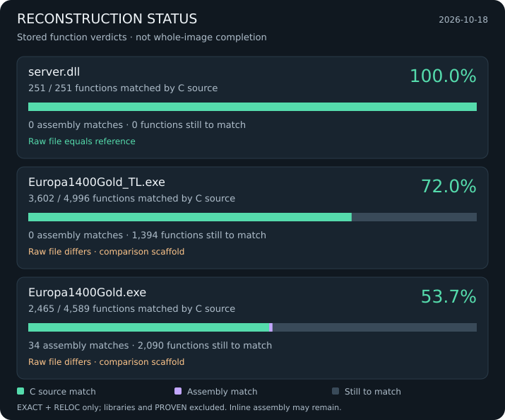

# Guild Rebrew: Europa 1400 Decompilation

Use Rebrew's current CLI and shipped skills for inventories, source edits and
verification. [Tooling and upstream changes](docs/tooling-upstream.md) lists the
remaining project-specific scripts and replacements for retired experiments.
The vendor build check requires upstream Rebrew with `rebrew library vendor`.

Byte-identical C89 source reconstruction of **Europa 1400: The Guild** (`server.dll`).

Uses the [rebrew](../rebrew/) toolchain for compiler-in-the-loop decompilation matching with MSVC6 in Docker.

<!-- progress:start -->
<p align="center">
  
</p>
<!-- progress:end -->

## Reference binary

The authoritative `server.dll` reference is the **untouched GOG The Guild Gold
version**, stored at `original/Server/server.dll` with read-only permissions
(`0444`). It is 286,720 bytes; its SHA-256 is:

```text
3cc2ce9049e41ab6d0eea042df4966fbf57e5e27c67fb923e81709d2683609d1
```

Verified on 2026-10-02 by extracting `app/Server/server.dll` directly from the GOG
installer `setup_the_guild_gold_2.0.0.5.exe` in
`/home/maci/Desktop/Projects/Europa1400/GILDE/`. The extracted DLL, the Steam Gold
v2.06 English international DLL, and this project's reference are byte-identical.
The GOG-labelled directory in `gilde-binaries/` is a symlink to the Redump DVD
directory; provenance was therefore checked against the installer itself.

Verify the reference from the project root:

```bash
sha256sum --check <<'EOF'
3cc2ce9049e41ab6d0eea042df4966fbf57e5e27c67fb923e81709d2683609d1  original/Server/server.dll
EOF
```

## Quick Start

```bash
# Install dependencies (pulls in rebrew tooling package)
uv sync

# All rebrew CLI tools work from this directory:
rebrew todo --json               # prioritized action items
rebrew todo -c start-function --json  # only new functions to start
```

## Decompilation Workflow

```bash
# 1. Find a function to work on
rebrew todo --json

# 2. Generate a skeleton .c file
rebrew skeleton 0x10003DA0

# 3. Write C89 source (see AGENTS.md for rules)
#    - Declare ALL variables at block top
#    - No for(int i=...): declare int i; separately
#    - No // comments (use /* */)

# 4. Test your implementation (auto-updates STATUS)
rebrew test src/Develop/<path>/my_func.c

# 5. If near-miss, check the diff and try the GA
rebrew diff src/Develop/<path>/my_func.c -m   # structural diffs only
rebrew match run src/Develop/<path>/my_func.c --generations 200 --pop-size 64 -j 16 # GA search

# 6. Single-file flag sweep
rebrew match flags src/Develop/<path>/my_func.c
```

## Compiler Flags by Origin

| Origin | CL flags | Notes |
|--------|----------|-------|
| **GAME** | `/nologo /c /O2 /MT /Gd` | Full optimization, cdecl |
| **MSVCRT/CRT** | Stock `LIBCMT.LIB` linked unchanged | Library attribution; no reconstructed CRT source |
| **ZLIB** | `/nologo /c /O2 /MT /Gd` | Matches with /O2 |

## Project Structure

```
guild-rebrew/
├── src/Develop/          # Reversed C, mirrors the original D:\Develop tree (all targets)
├── src/GOLD*.fcn_*.c     # Client-only functions with no shared source yet
├── original/             # Target binaries (gitignored)
├── references/          # Vendored zlib 1.1.3 and minizip: pristine upstream + patches (docs/vendoring.md)
├── db/                   # Function inventories (tracked), coverage data (ignored)
├── docs/                 # Codegen notes, traps, naming, TODO (map: docs/README.md)
├── layout/server.dll/    # Link layout package
├── rebrew-project.toml   # Project configuration
└── AGENTS.md             # Full project reference
```

The MSVC6 compiler is not vendored: every CL.EXE/LINK.EXE call runs through
a docker image: `rebrew/msvc:6.0-sp5-win32` for the server, `rebrew/msvc:6.0-sp5-pp-win32`
for both clients (see `cmake/toolchain-msvc-6.0-sp5-docker.cmake`).

## Documentation

| Document | Description |
|----------|-------------|
| [AGENTS.md](AGENTS.md) | Full project reference for AI agents and contributors |
| [docs/README.md](docs/README.md) | Which doc answers which question |
| [docs/msvc6-c-shapes.md](docs/msvc6-c-shapes.md) | C spellings that compile to the target's exact bytes, indexed by diff symptom |
| [docs/msvc6-allocator.md](docs/msvc6-allocator.md) | Register allocation notes |
| [docs/codegen-walls.md](docs/codegen-walls.md) | Encodings no C spelling reaches |
| [docs/measure-traps.md](docs/measure-traps.md) | Rulers and tools that gave wrong readings |
| [docs/msvc6-link-layout.md](docs/msvc6-link-layout.md) | Linker and PE layout outside `.text` |
| [docs/general-knowledge.md](docs/general-knowledge.md) | Facts about the original build and toolchain |
| [docs/naming_conventions.md](docs/naming_conventions.md) | Original developer naming conventions |
| [docs/TODO.md](docs/TODO.md) | Open work and the .text link shortfall |

## Targets

| Target | Binary | Role |
|--------|--------|------|
| `server.dll` | `original/Server/server.dll` | Default |
| `Europa1400Gold_TL.exe` | `original/Europa1400Gold_TL.exe` | Active focus |
| `Europa1400Gold.exe` | `original/Europa1400Gold.exe` | Validation |

Game knowledge: [docs/game-compendium.md](docs/game-compendium.md): canonical
compendium (game, binaries, tree, network, community ecosystem).

## License

MIT
